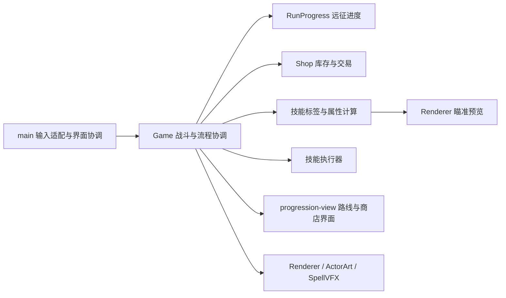
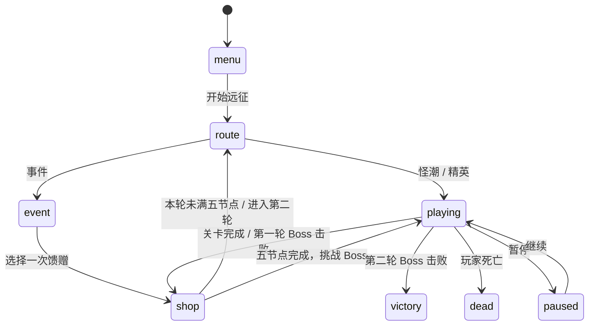

# 架构与远征流程 v0.5

日期：2026-10-23。商店与装备规则已更新，当前以 [三类商店 v0.7](shop-v0.7.md) 为准。本文是新增架构与局内流程的实现基准；十种基础法术操作继续遵循核心规格。

## 已确认方向

逻辑与表现尽量分离；技能具有标签以支持 Roguelite 强化；唯一货币为金币；每关结束进入可刷新的遗物和主动装备商店；路线包含怪潮、精英和事件；每轮五个路线节点后打 Boss，共两轮。

## 模块边界



领域模块不引用 DOM、Canvas 或音频。界面只展示状态和发出命令；金币扣款、库存、所有权、状态合法性在逻辑层重新验证。绘制层不能计算伤害或推进进度。`effects` 中范围、延迟、寿命等是模拟实体参数，特效按照它们绘制；命中特效、飘字及角色动作仍通过同一状态模型供绘制层读取。当前没有额外引入 ECS、依赖注入框架或通用事件总线。

| 文件 | 职责 | 后续扩展入口 |
| --- | --- | --- |
| `config.js` / `equipment.js` / `attributes.js` | 技能、遗物、装备静态目录 | 新增内容与数值 |
| `spell-rules.js` | 稳定机器标签、强化匹配与最终属性 | 范围、冷却、多重施法规则 |
| `spell-executor.js` | 十种技能创建模拟实体、施加初始状态 | 新技能行为及形态遗物 |
| `game.js` | 命令校验、战斗步进、碰撞伤害、模块协调 | 后续逐步抽出敌人和状态系统 |
| `enemy-definitions.js` / `enemy-ai.js` | 小兵配置、兵种组合与行为状态机 | 兵种、前摇、回能与冲锋规则 |
| `enemy-intents.js` | 读取攻击快照绘制意图预警 | 扇形、路径、回能提示 |
| `run.js` | 两轮进度、节点计数、Boss 门槛与历史 | 章节数、节点数、路线池 |
| `shop.js` | 商品抽取、刷新费用、购买事务 | 稀有度、权重、商品槽位 |
| `progression-view.js` / `main.js` | 只读界面模板、输入、HUD | 新事件文案、路线呈现 |
| `renderer.js` / `vfx.js` / `actors.js` / `enemies.js` | 战场、特效和角色绘制 | 美术与动画 |

`Game` 保留为现有调用方的门面。本轮拆出最常变化的技能入口、商店和进度；持续效果步进和伤害仍在 Game；小兵 AI 已拆出，详见 [小兵设计](enemy-ai-v0.5.md)，后续可在现有回归保护下继续拆分。

## 技能与强化契约

技能定义包含 `id`、输入组合、机器 `tags`、基础参数与展示信息。标签使用英文稳定标识，不用中文 `type` 文案进行规则匹配。元素标签表示组合来源，不自动代表伤害属性。

强化实例格式示例：

```js
{ tags: ['area'], areaAdd: 0.25 }
{ tags: ['area'], extraCasts: 1 }
{ spell: 'WWW', cooldownMultiplier: 0.8 }
```

`spell` 精确匹配；`tags` 全部满足才生效，两者同时提供时同时满足。不修改基础定义：每次施法和预览均通过 `resolveSpellStats` 得到最终属性。相同属性先累加 Add，再乘各个 Multiplier。范围倍率限制在 0.1–5，施法次数限制在 1–8，冷却最少 0.1 秒。

范围当前指半径、投射物宽度或冰墙长度，不是施法射程；冰墙厚度保持原值。专属遗物先改变基础形态或参数，再叠加通用强化。复唱符印只重复 `area` 技能，在同一时刻、落点和方向创建独立实体，只校验、扣冷却和记施法次数一次。伤害逐个实体结算，原有灼烧刷新、浮空无敌、单个声波命中集合规则继续有效；多重施法不保证所有伤害在控制无敌期间都能生效。自身增益、召唤及单位标记不参与通用复唱，避免无意义刷新和召唤替换。

三重陨石是一次执行生成三条弹道；复唱后执行两次，生成六条弹道，每条独立维护命中计时。不同技能的持续时间、伤害和召唤数量仍由专属行为管理，尚未声称支持任意属性强化。

## 远征状态与结算



开局也选路线；怪潮、精英、事件都计入五节点。商店、刷新和 Boss 不计节点。第五节点完成后先购物，再直接挑战本轮 Boss。第一轮 Boss 后有商店，第二轮 Boss 后直接胜利。可以连续选择事件，这是当前明确采用的原型规则；后续限制事件出现频率只需调整路线供应规则。

关卡边界自动收取剩余金币，清空敌人、召唤物、弹丸、地面技能、临时增益与控制；保留生命、金币、遗物、装备所有权、法术和装备冷却。进入下个节点恢复 20 生命。非战斗状态冻结模拟与冷却。结算只能推进一次，第二轮不重置局内成长。

## 暂定数值与内容范围

- 怪潮与精英节点清理全部敌人后过关，无时间限制。每关有有限数量的援军，全部出场且全部击败后结算；短暂无敌人但仍有援军时不会提前过关。基础援军数为 12，每个路线深度增加 2；精英节点额外生成一名强化近战兵。结算分别奖励 35 / 65 金币。Boss 关也须清理全部敌人。HUD 显示剩余敌人数（含未出场援军），进度条表示击杀进度。
- 事件目前为祭坛二选一：30 金币或恢复 50 生命；事件不再额外给关卡金币。
- Boss 结算奖励 100 金币，另有原有 100 金币掉落。第一轮斧王 2400 生命，第二轮伐木机 4800 生命；独立技能、满蓝大招与分阶段 AI 见 [Boss 设计](bosses-v0.6.md)。
- 普通商店三栏各抽 3 项：可重复购买的属性、本局唯一的机制遗物、当前未装备的主动或被动装备；遗物不足则只展示剩余项。主动与被动共用一个槽，购买新装备会移除旧装备，不返金币。
- 刷新首次 10 金币，每次增加 5，进入下一家商店重置；随机抽样允许刷新后出现相同商品。购买后移出可交易库存，保留已购买卡片至刷新；已拥有遗物不再入池。属性与装备仍可刷新。
- 普通商店以金币购买属性、遗物与装备，无免费遗物。试炼仍有 9999 金币、全部商品和免伤，刷新关闭，不推进正常远征；重开试炼补给可再次购买属性。
- 扩域透镜已由可重复的范围属性替代；复唱符印仍为 65 金币机制遗物。旧角色遗物归入被动装备，遗物现为 12 件。

## 验证与后续工作

自动化验证覆盖原有技能、遗物、装备与绘制回归，及两轮完整流程、事件计数、商店事务、范围命中与复唱组合。界面验证覆盖营地、路线、事件、金币、刷新及装备页。

新增内容优先只改对应模块。小兵状态机现已独立；等持续效果和状态机制明显增长后，再将 `tickEffect`、伤害与状态拆为独立系统；届时增加独立表现事件队列，进一步减少 Game 中的飘字和动作字段。
